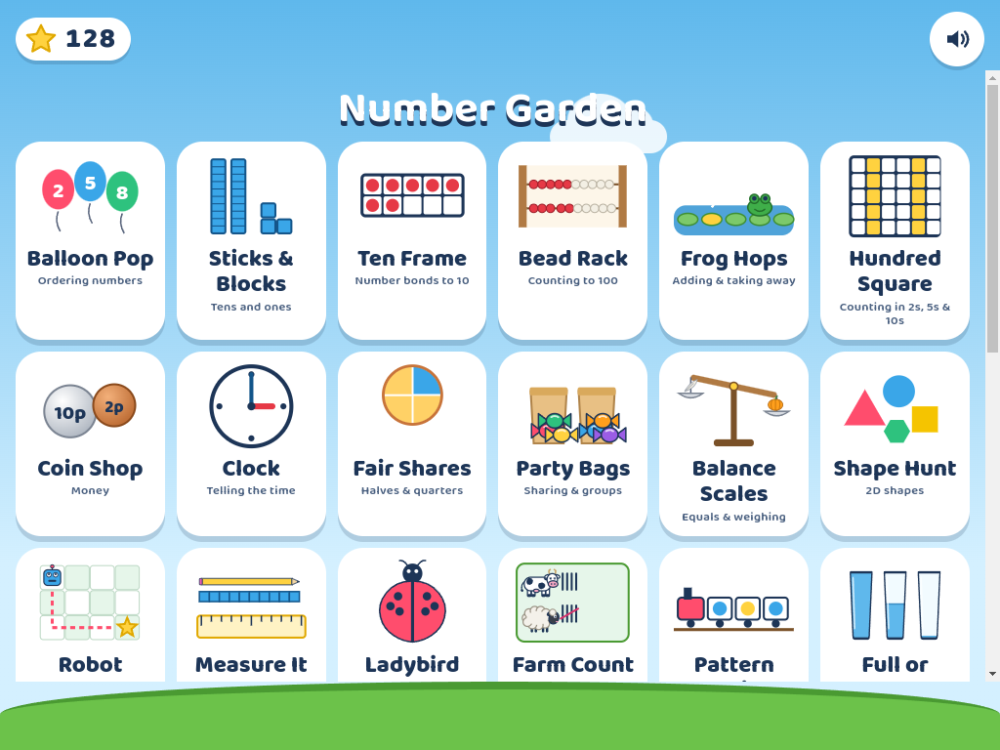
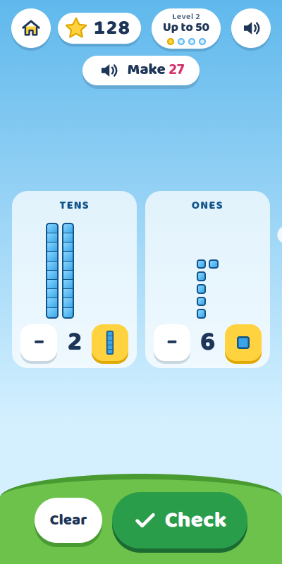
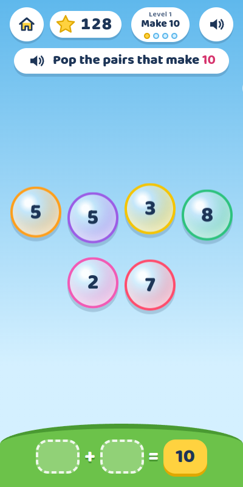
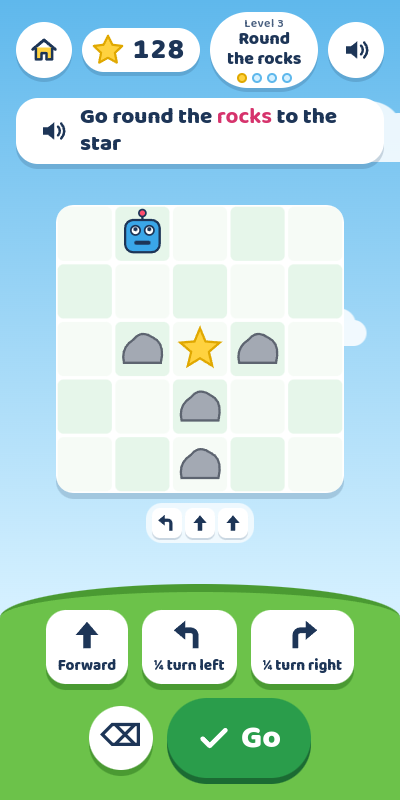
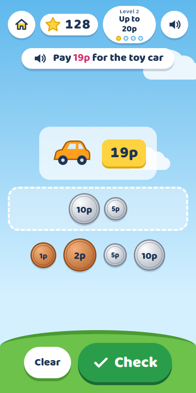
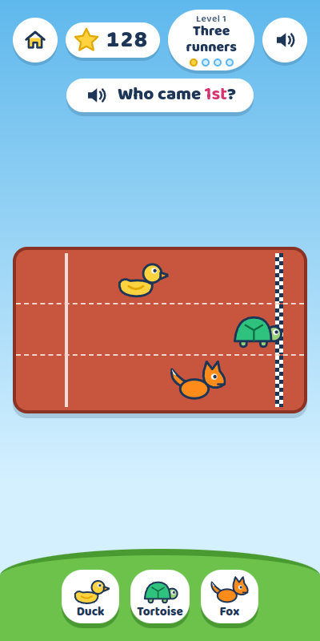
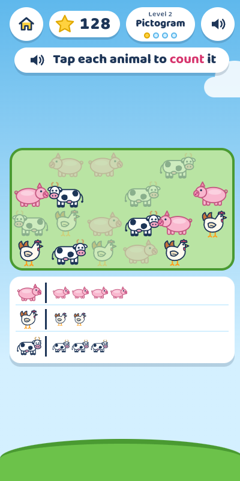
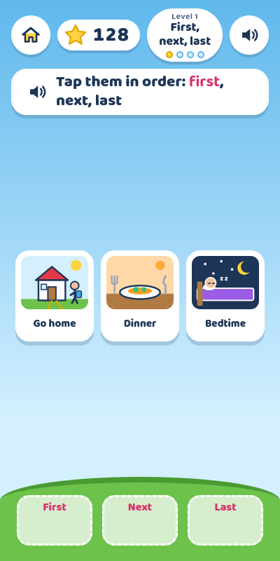
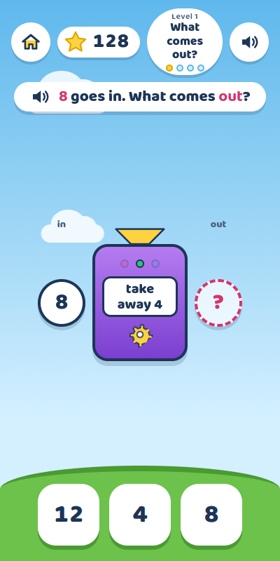
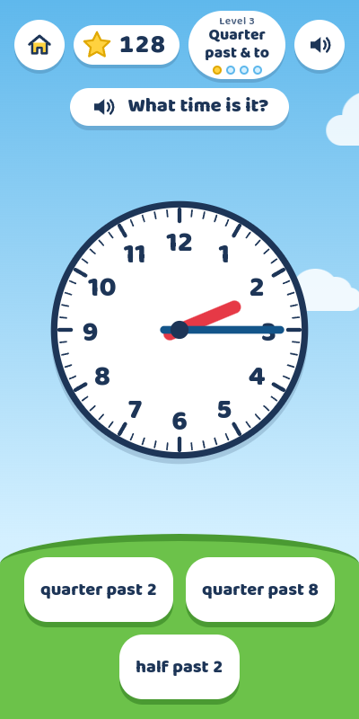

# Number Garden 🌱

**Free maths games for 5–7 year olds, built around the Year 1 and Year 2 national curriculum (England).**
36 games, big buttons, every instruction read aloud, stars for right answers and nothing lost for wrong ones.
It works on an iPad, Android tablet, phone or computer, and keeps working offline.

**Play it now: <https://tomtranter.github.io/maths-play/>**



<table>
<tr>
<td></td>
<td></td>
<td></td>
</tr>
<tr>
<td></td>
<td></td>
<td></td>
</tr>
<tr>
<td></td>
<td></td>
<td></td>
</tr>
</table>

---

## Put it on your child's tablet (2 minutes)

1. Open **<https://tomtranter.github.io/maths-play/>** on the tablet.
2. **iPad / iPhone:** tap **Share** (the square with an arrow), then **Add to Home Screen**.
   **Android:** tap the **⋮** menu, then **Install app** (or **Add to Home screen**).
3. Open it once from the new icon **while on wifi** and leave it for a minute: it downloads the voice so it
   can play offline afterwards.

That's it. Nothing to sign up for, no adverts, and nothing about your child is sent anywhere: stars and
levels are saved only on that device.

## Hints for grown-ups

- **Sit with them for the first game or two.** Show them the speaker button on the instruction: tapping it
  repeats what to do, so children who can't read yet can play on their own.
- **Little and often.** Ten minutes a day beats an hour on Saturday. Each game has three levels; four right
  answers move up a level, so the challenge grows with them.
- **Choose a level.** Tap the level button at the top of a game (e.g. *Level 2 · Count in 5s*) to pick any
  level, including going back to an easier one.
- **Mistakes are fine.** A wrong answer just gives a gentle hint and another go; stars are never taken away.
  A right answer first time earns 2 stars, after a hint 1 star.
- **Talk about it.** Ask *"How did you know?"* or *"Can you show me on your fingers?"*. Saying the maths out
  loud is where a lot of the learning happens.
- **Sound off?** The speaker button at the top right turns all sound on and off. On an iPad, the silent switch
  can also mute it.
- **Starting afresh:** progress lives in the browser, so clearing the website's data (or deleting and
  re-adding the home-screen icon) resets stars and levels.

## The games

| Game | What it practises | Curriculum |
| --- | --- | --- |
| Balloon Pop | Ordering 3 numbers, smallest or biggest first | Y1 compare and order numbers |
| Sticks & Blocks | Making and reading 2-digit numbers with tens and ones; swapping 10 ones for a ten | Y1/Y2 place value |
| Ten Frame | Counting, making numbers, "how many more to make 10?" | Y1 number bonds within 10 and 20 |
| Bead Rack | A rekenrek (number rack) with 20 and 100 beads in fives | Y1 count to 100, groups of 5 and 10 |
| Frog Hops | Adding and taking away by hopping along a number line | Y1 add and subtract within 20 |
| Hundred Square | Counting in 10s, 5s and 2s; one more and one less | Y1 count in 2s, 5s, 10s; one more/less |
| Coin Shop | Paying with UK coins; counting a purse of coins | Y1 recognise coins; Y2 combine amounts |
| Clock | Reading and setting o'clock, half past, quarter past and to | Y1/Y2 telling the time |
| Fair Shares | Shapes cut into equal halves and quarters | Y1 halves and quarters |
| Party Bags | Sharing sweets into bags; equal groups; counting in 2s, 5s, 10s | Y1 grouping and sharing; Y2 times tables |
| Balance Scales | Heavier and lighter; making both sides equal (8 + 5 = 10 + ?) | Y1 mass; the = sign and missing numbers |
| Shape Hunt | Finding shapes; sides and corners; "What am I?" riddles | Y1/Y2 2D shapes |
| Robot Route | Programming a robot with forward and turn moves | Y1/Y2 position, direction, quarter turns |
| Measure It | Longer and shorter; measuring with cubes; using a cm ruler | Y1/Y2 length |
| Ladybird Doubles | Doubles and halves; pairing socks for odd and even | Y1/Y2 doubling, halving, odd and even |
| Farm Count | Counting animals into a tally chart or pictogram, then reading it | Y2 statistics |
| Pattern Train | Colour, shape and number patterns | Y2 patterns and counting in steps |
| Full or Empty | Full, half full, empty; which container holds more | Y1/Y2 capacity |
| Hungry Crocodile | <, > and = (the crocodile eats the bigger number) | Y1/Y2 comparing numbers |
| Cherry Bonds | Part-whole "cherry" diagrams; missing numbers like ? + 3 = 7 | Y1/Y2 number bonds, inverse |
| Flower Arrays | Arrays in rows; 2, 5 and 10 times tables | Y2 multiplication |
| Calendar Caterpillar | Days of the week, months and seasons | Y1 time and dates |
| Rocket Number Line | Placing and reading numbers on a number line | Y1/Y2 number line, estimating |
| Café Change | Adding prices and giving change in pence and pounds | Y2 money |
| Read the Scale | Thermometers and measuring jugs marked in 10s, 5s and 2s | Y2 temperature and capacity |
| Butterfly Symmetry | Mirror patterns and spotting symmetry | Y2 line symmetry |
| Number Words | Matching "fourteen" to 14 and to a picture | Y1 numbers in words |
| Fraction Party | Halves, thirds and quarters of a plate of treats | Y2 fractions of amounts |
| Bubble Bonds | Popping pairs that make 10, 20 and 100 | Y1/Y2 number bonds |
| Make Ten Bridge | Adding 8 + 5 by filling a ten frame first | Y1/Y2 adding across 10 |
| Sorting Baskets | Sorting pictures and numbers (odd/even, more/less than) | Y1/Y2 sorting |
| My Day | Putting the day in order; morning, afternoon, evening | Y1 sequencing events |
| Hungry Bear | Take away: how many cookies are left? | Y1 subtraction |
| Number Machine | Function machines: what comes out, what went in, what's the rule? | Y2 inverse operations |
| Dice Dash | Dice patterns at a glance; adding two dice | Y1 subitising and addition |
| Race Day | 1st, 2nd, 3rd: ordinal numbers in a race | Y1 ordinal numbers |

---

## Make your own copy

You can have your own version (your own name, colours and choice of games, and your own new games),
hosted free on GitHub Pages.

**The easy way: with Claude Code.** Install [Claude Code](https://claude.com/claude-code), then in a terminal:

```bash
git clone https://github.com/TomTranter/maths-play.git && cd maths-play && claude
```

and ask in plain English. This repository comes with three skills that Claude uses automatically:

| Ask something like… | Skill | What happens |
| --- | --- | --- |
| *"Help me set up my own copy and put it on my iPad"* | `make-it-yours` | Forks the repo, turns on GitHub Pages, explains the tablet steps |
| *"Rename it Our Maths and make it purple"* / *"Hide the money games"* / *"Make Frog Hops easier"* | `make-it-yours` | Changes the right files for you |
| *"Add a game about sharing pizza between friends"* | `add-game` | Writes the game, records its voice, tests every level |
| *"Publish it"* | `publish` | Self-tests, commits, pushes and checks the live version |

**The manual way:** fork this repository on GitHub, then in your fork go to **Settings → Pages**, choose
**Deploy from a branch**, branch `main`, folder `/ (root)`. Your copy appears at
`https://<your-username>.github.io/maths-play/` a minute later. Free GitHub accounts need the repository to be public.
Please don't put your child's name or anything personal in it.

## Adding or changing games

Each game is **one file** in [`js/games/`](js/games/): its picture, rules, everything it says and a built-in test.
[`docs/ADDING_A_GAME.md`](docs/ADDING_A_GAME.md) explains the shape of a game and the helpers available,
[`js/games/croc.js`](js/games/croc.js) is a complete example, and [`tools/game-template.js`](tools/game-template.js)
is a starting point. The short version:

```bash
cp tools/game-template.js js/games/mygame.js        # then edit it
node tools/collect_lines.mjs mygame                 # check it loads and what it will say
python3 tools/register_games.py                     # add it to the app
nice -n 10 uv run tools/make_voice.py               # record the new lines (see "The voice" below)
python3 -m http.server 8000                         # open http://localhost:8000/?selftest=mygame
```

### Hints for game makers

- **Every round must be possible with what's on the screen.** Don't ask for 25 counters when there are 20 spaces.
  The self-test (`?selftest`) plays every level using the game's own `test.answer()` and reports rounds it can't win.
- **Speak everything.** Children who can't read rely on the voice. List every sentence in `voiceLines()`;
  the self-test reports any sentence that has no recording.
- **Hints, never penalties.** Use `miss("Count them again.")` for wrong answers.
- **Think phone first.** Check it at 400×800 with big buttons (at least 44px) and no scrolling.
- **Keep sentences short and reusable.** Each different sentence is one recording, so "There are 7 apples." is
  better than one long sentence that mixes several numbers.

## The voice

Everything is spoken by **Cori**, a natural-sounding British voice recorded into the app (about 5,000 short
clips in `audio/cori/`), so it sounds the same on every device and works offline. Clips are made with
[Piper](https://github.com/rhasspy/piper) using the `en_GB-cori-high` voice, trained on public-domain
[LibriVox](https://librivox.org) recordings.

You only need this when you add or change spoken lines:

```bash
mkdir -p ~/.cache/piper-voices && cd ~/.cache/piper-voices
base=https://huggingface.co/rhasspy/piper-voices/resolve/main/en/en_GB/cori/high
curl -LO "$base/en_GB-cori-high.onnx" -LO "$base/en_GB-cori-high.onnx.json" && cd -
nice -n 10 uv run tools/make_voice.py        # records only lines that don't have a clip yet
```

Recording uses a lot of CPU for a few minutes (`nice` keeps your computer responsive). Lines that somehow have
no recording fall back to the device's own voice.

## How it's built

Plain HTML, CSS and JavaScript: no build step, no frameworks, no tracking, no network requests (the
[Baloo 2](https://fonts.google.com/specimen/Baloo+2) font is bundled). A service worker caches everything for offline play.

```
index.html                page shell; loads core, every game, then main
css/app.css               shared styles and colours
js/core.js                engine: sound, voice, effects, stars, levels, choices, routing
js/games/*.js             one file per game
js/main.js, js/selftest.js  start-up; ?selftest runner
sw.js                     offline cache
audio/cori/               the recorded voice
tools/                    register_games.py, make_voice.py, collect_lines.mjs, game-template.js
docs/                     ADDING_A_GAME.md, screenshots
.claude/skills/           add-game, publish, make-it-yours (for Claude Code)
```

## Licence and credits

Code: MIT (see [LICENSE](LICENSE)). Font: Baloo 2, SIL Open Font License ([fonts/OFL.txt](fonts/OFL.txt)).
Voice: Piper `en_GB-cori-high`, trained on public-domain LibriVox recordings.
